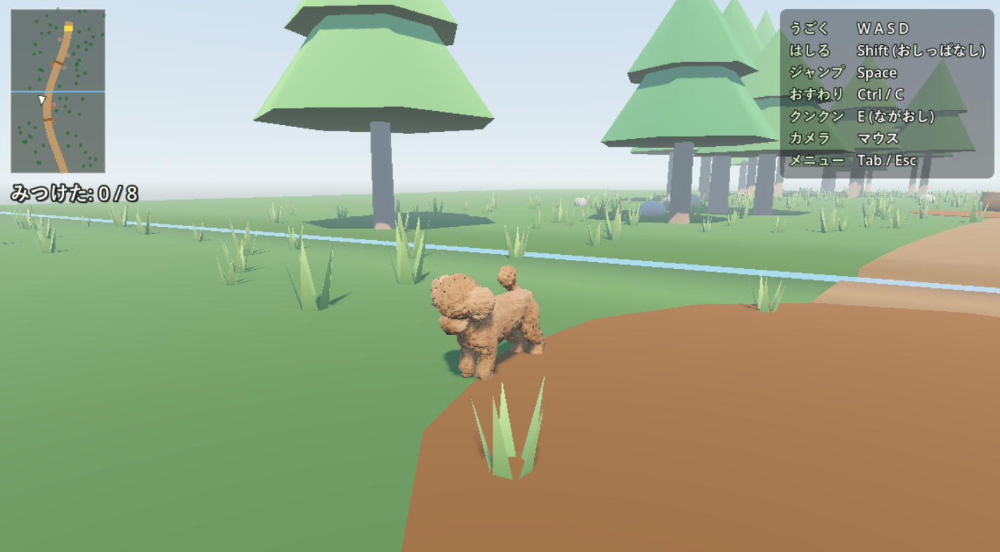

# たるちゃんの おさんぽ

犬の「たるちゃん」を操作して、森の小道をのんびりおさんぽする3Dゲームです。
落ちている「いいもの」をクンクン嗅ぎあてて集め、1回のおさんぽが「おさんぽ日記」の1ページになります。

## 遊ぶには

1. [Releases](https://github.com/KazukiNakaya/taruchan-game-sample/releases) から、最新の `taruchan-sanpo-v*-windows.exe` をダウンロードします。
2. ダウンロードしたexeを起動すると、ゲームが始まります(インストール不要)。

### ソースから動かす場合

1. [Godot Engine 4.7](https://godotengine.org/) をダウンロードします。
2. Godot を起動して「インポート」から、このフォルダの `project.godot` を開きます。
3. 右上の「プロジェクトを実行」(F5)で、ゲームが始まります。

動作環境: Windows(PC)。キーボード・マウス、またはゲームパッドで遊べます。

## 遊び方

タイトル画面で「はじめる」を選ぶと、おさんぽが始まります。
森の小道を歩いて、地面に埋まっている「いいもの」を探しましょう。

- いいものに近づくと、たるちゃんの首がそちらを向きます。しっぽも速く振れます。
- 近づいて **クンクン**(ながおし)すると、掘り出せます。
- 「ちょうちょ」が現れたら、ついていくと、隠れたいいものの場所へ案内してくれます。
- ベンチの前で **おすわり**すると、おさんぽがおしまいになります。
- 画面左上のマップと、「みつけた ○ / ○」で、全体の様子と見つけた数が分かります。
- おすわりしている間は、マップに いいもののだいたいの場所が、ぼんやり出ます。
- 見つけたものは「にっき」と「ずかん」に記録されます(メニューから見られます)。

### 操作

画面の右上にも、使っている入力に合わせた操作一覧が出ます。

| 操作 | キーボード・マウス | ゲームパッド |
|---|---|---|
| うごく | W A S D | 左スティック |
| はしる | Shift(おしっぱなし) | LT / L2 |
| ジャンプ | Space | B / ○ |
| おすわり | Ctrl / C | Y / △ |
| クンクン | E(ながおし) | A / ✕(ながおし) |
| カメラ | マウス | 右スティック |
| メニュー | Tab / Esc | Start |

メニューには「にっき」「ずかん」と、「タイトルにもどる」「おわる」があります。

## クレジット

- ちょうちょのモデル: [Butterflies](https://www.fab.com/listings/d3d80956-31a2-4395-959f-c592002c83c7) by Riada
  ([CC BY 4.0](https://creativecommons.org/licenses/by/4.0/))。
  2匹のうち青い方を使い、ゲームに合わせて大きさを変えています。
